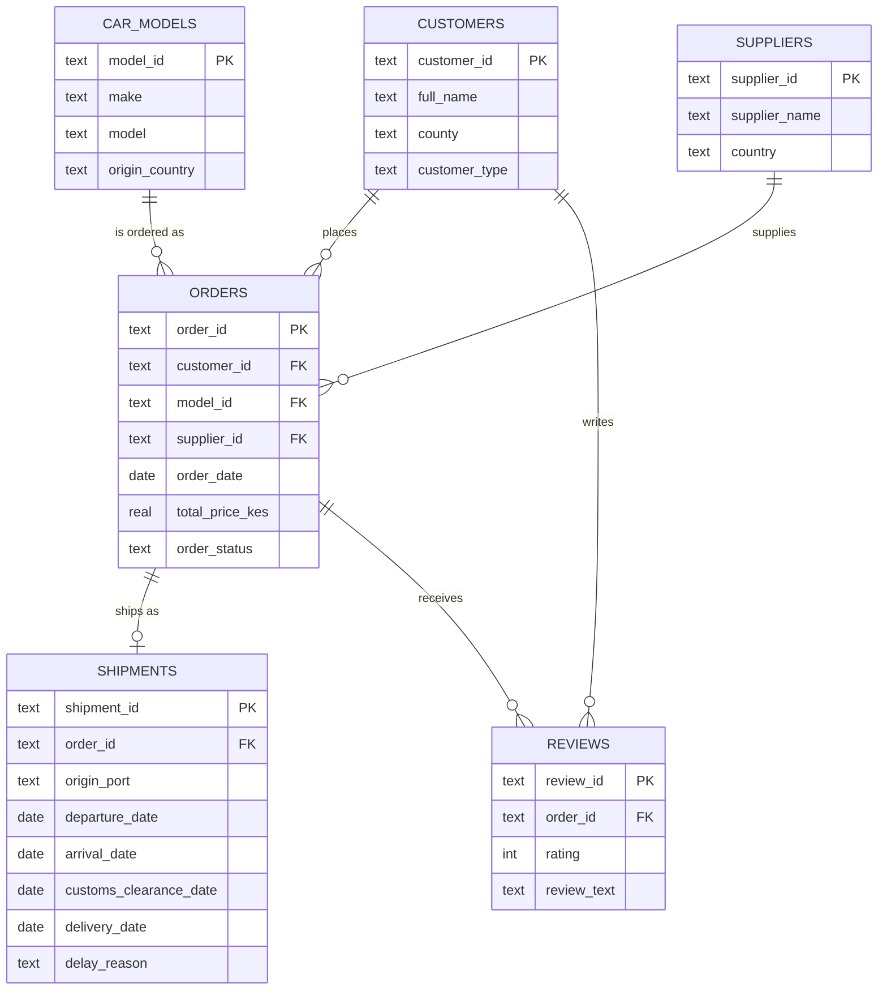

# 🚗 Car Import Dealer: End-to-End ETL & Analytics Pipeline

An end-to-end data engineering project built around a Kenyan used-car import business. It takes messy raw CSV exports (orders, shipments, customers, suppliers and reviews) and turns them into a clean, normalised relational database. SQL joins and window functions then power an analytics dashboard.

**Stack:** Python · pandas · SQL (SQLite) · matplotlib


---

## 📌 Business Context

A car dealer in Nairobi imports vehicles from **Japan, the UK, UAE, Thailand and South Africa** through the **Port of Mombasa**. Operations data is scattered across spreadsheets with inconsistent formats, duplicates and missing values. This pipeline consolidates it into a single source of truth so the business can answer questions such as:

- How long does a car take to reach the customer, and where is the time lost (sea transit, KRA customs clearance, or inland delivery)?
- Do shipping delays hurt customer ratings?
- Which makes, suppliers and counties drive revenue?
- How much of the customer's price is vehicle cost vs freight, duties and VAT?

## 🏗️ Architecture

```
01_raw_data/              02_database/etl.py                  03_analysis/analysis.py
      │                     │                                      │
      ▼                     ▼                                      ▼
 01_raw_data/*.csv ──►  EXTRACT ► TRANSFORM ► LOAD  ──►  car_dealer.db  ──►  SQL joins  ──►  charts/*.png
 (6 messy files)       read     clean &      insert     (SQLite,           + window
                                validate     in FK      relational)        functions
                                             order
```

## 🗄️ Database Schema



Also included:
- **`etl_rejects`**: an audit table that logs every row the pipeline refuses to load, and why.
- **`v_order_shipping`**: a view that derives `transit_days`, `clearance_days`, `last_mile_days` and `order_to_delivery_days`.
- **Constraints and indexes**: primary and foreign keys, `CHECK` constraints (rating 1–5, valid order status) and indexes on join columns.

## 🧹 Data Cleaning (Transform Step)

The raw data is deliberately messy, like real operational exports. The pipeline handles:

| Problem | Fix |
|---|---|
| Duplicate rows (62 across 4 files) | De-duplicated on primary key |
| Mixed date formats (`2025-03-01`, `01/03/2025`, `03-01-2025`) | Parsed to ISO `YYYY-MM-DD` |
| Inconsistent case and stray whitespace (`DELIVERED`, `nairobi `) | Standardised |
| Phone formats (`07…` vs `+254…`) | Normalised to `+254XXXXXXXXX` |
| Prices stored as text (`KES 1,298,600`) | Parsed to numeric |
| Ratings as `4/5` and `4` | Converted to integer |
| Missing emails, mileage and review text | Stored as `NULL` (payment method becomes `Unknown`) |
| Orphan foreign keys | Rejected and logged to `etl_rejects` |

The loader inserts parent tables first and finishes with `PRAGMA foreign_key_check`, so the database is verified to have **0 integrity violations**.

## 📊 Analysis & Findings

`analysis.py` runs eight multi-table SQL queries (joins across up to four tables, CTEs and window functions) and plots the results. Findings from the generated dataset:

- **UK imports are the slowest**, at about 73 days from order to delivery, against about 54 for the UAE.
- **Delays hurt satisfaction**: delayed shipments average a 2.99 rating against 3.93 for on-time ones.
- **Paperwork is the bottleneck**: KRA system downtime, documentation errors and customs inspections add about 9 extra clearance days compared with weather or port congestion.
- **Toyota leads** on both revenue and units, and **Nairobi, Mombasa and Kiambu** are the top three counties by revenue.
- **Duties and VAT make up roughly 30–45%** of the landed cost, depending on origin and engine size.

<details>
<summary>Example query: average days per stage by origin</summary>

```sql
SELECT origin_country,
       ROUND(AVG(transit_days),1)   AS transit,
       ROUND(AVG(clearance_days),1) AS clearance,
       ROUND(AVG(last_mile_days),1) AS last_mile
FROM v_order_shipping
WHERE order_status = 'Delivered'
GROUP BY origin_country
ORDER BY transit + clearance + last_mile;
```
</details>

## 📁 Project Structure

```
car-sales/
├── 01_raw_data/              # Part 1: raw data
│   ├── *.csv                 #   6 raw CSV files (input)
│   └── generate_data.py      #   seeded synthetic data generator
├── 02_database/              # Part 2: ETL and database
│   ├── schema.sql            #   DDL: tables, keys, constraints, indexes, view
│   ├── etl.py                #   extract, transform and load pipeline
│   └── car_dealer.db         #   output SQLite database
├── 03_analysis/              # Part 3: analytics
│   ├── queries.sql           #   10 analytical SQL queries
│   ├── run_queries.py        #   runs queries.sql and prints results
│   ├── analysis.py           #   joint SQL queries + matplotlib dashboard
│   └── charts/               #   dashboard and individual chart PNGs
└── requirements.txt
```

## 🚀 Getting Started

```bash
git clone https://github.com/<your-username>/car-sales.git
cd car-sales
pip install -r requirements.txt

python 01_raw_data/generate_data.py   # (optional) regenerate the raw CSVs
python 02_database/etl.py             # build 02_database/car_dealer.db
python 03_analysis/run_queries.py     # print results of queries.sql
python 03_analysis/analysis.py        # create charts in 03_analysis/charts
```

You can also explore the database directly:

```bash
sqlite3 02_database/car_dealer.db "SELECT * FROM v_order_shipping LIMIT 5;"
```

## 🔭 Roadmap

- [ ] Swap SQLite for **PostgreSQL** and run it in Docker
- [ ] Orchestrate the pipeline with **Apache Airflow**
- [ ] Land raw files in **AWS S3** and move transforms to **Glue / PySpark**
- [ ] Query the curated layer with **Athena**
- [ ] Add data-quality tests (Great Expectations or pytest)
- [ ] Interactive dashboard (Streamlit)

## ⚠️ Note on the Data

All data is **synthetic**. It was generated with realistic Kenyan import costs, routes and shipping times, but it contains no real customers or business records.

## 👤 Author

**Job Kamau**: Data Engineer | IT Systems Specialist, Nairobi, Kenya
[LinkedIn](https://www.linkedin.com/in/job-gathereri-7865b910b)
